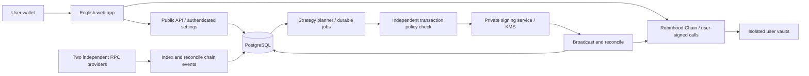

# Domino — public MVP plan

**Working name · 9 September 2026 · English product, Robinhood Chain only**

This is a product proposal based on the personal bot. It does not change the live strategy, its permissions, or its fees. The name has not been checked for trademarks or domain availability.

## 1. The product to build

**Help people who already trade tokens with their own wallet create, understand, and maintain their first liquidity position.**

The customer knows how to connect Rabby or another wallet, approve a transaction, and buy a meme coin. The unfamiliar decisions are which pair to use, how much of each token is needed, what a price range does, why a position stops earning fees, and whether fees have compensated for changes in the underlying assets.

Suggested positioning:

> Create your first liquidity position. See how it works. Automate the upkeep.

The first product should combine **guided position creation + automatic fee reinvestment + understandable accounting**. Domino is an opt-in strategy in the first invited functional alpha, building successive positions from fees. Importing an existing LP NFT is a secondary entrance, not a prerequisite.

This is a different initial audience from experienced LPs looking for a more sophisticated analytics terminal. A wallet tutorial, social login, embedded wallet, and fiat purchase flow are unnecessary for the first release.

## 2. What LP beginners must understand

The product must make the following visible through examples and position data, rather than a long tutorial before entry:

- As the token rises through a token/stable range, the position exchanges token exposure for stablecoin. Above the upper bound it can be entirely stablecoin and no longer earn active-range fees. For token/ETH or another pair, these outcomes are relative to the chosen quote asset, which can also change in dollar value.
- As it falls through the range, the position acquires more of the token. Below the lower bound it can be entirely the volatile token.
- Fees are separate from total profit. A position can earn fees and still lose money or underperform holding the starting assets.
- Compound adds liquidity using eligible fees. It does not stop the token falling or keep the original token quantity constant.
- A Domino position uses fees to add another range. It does not automatically move the original principal, and its fee-funded size may be much smaller than the original position.

In product copy, say **position** and **range**. A new Domino is another position in the same underlying Uniswap pool, not the deployment of a new pool.

## 3. Scope and release boundary

| Capability | First public MVP | Later / controlled experiment |
|---|---|---|
| Network | Robinhood Chain mainnet, chain ID 4663 | Other chains |
| Assets | Robinhood wallet-token discovery and address search; user-selected pairs with rule-based token/pool/operation compatibility, including USDG and ETH paths | Additional hook adapters and nonstandard token/wrapper integrations |
| Entry | Create a position from wallet assets; import a compatible NFT | Advanced portfolio imports and migrations |
| Pool selection | Existing pools by pair/LP fee with TVL, rolling 24h volume and historical fee APR; study an explainable suggestion policy that excludes negligible volume | More extensive historical analytics and ranking research |
| New pools | Approved advanced creation of a missing compatible pair/fee pool, explicit initial price and bounded initialization plus first mint | Custom hooks and dynamic-fee integrations |
| Funding | Guided two-asset deposit; optional explicit, owner-signed balancing swap where a reviewed route exists | An atomic single-asset zap |
| Range | User-editable choices, effective tick-rounded boundaries, range-dependent token mix and price-outcome preview | Automated range selection or personalized recommendations |
| Maintenance | Maximum economically viable fee reinvestment, including bounded fee-balancing swaps after their implementation and audit | Automatic principal rebalancing |
| Domino | Opt-in in the first invited functional alpha on admitted markets; its implementation and review are release gates | Broader markets and expanded strategies |
| Wallet | Wallet remains the owner; wallet signs setup, changes, and exit | Embedded wallets, gas-credit custody |
| Ongoing gas | Operator funds gas; execution waits for viable economics | Subscription, explicit premium execution, alternate pricing |
| Revenue | 2% simple / 4% Domino on earned fees consumed by automation plus a separately disclosed assisted-swap fee during owner-requested setup/management; exact swap schedule pending | Other services with separately agreed fees |
| Token | Research and decision record only | Issuance, sale, liquidity, revenue distribution |

The [functional alpha scope](ALPHA_SCOPE.md) supersedes the earlier compound-only/read-only alpha proposal: users can select Auto-compound or Domino once the reviewed execution paths are ready. Internal read-only builds remain integration milestones. [Wallet-first onboarding and discovery](ONBOARDING_AND_POOL_DISCOVERY.md) supersedes the small token/stable catalogue as the only entrance: discover wallet assets and apply verified-manager, hookless/fixed-fee and operation-specific compatibility checks to candidates. Advanced new-pool creation is explicitly approved alpha scope.

Pair review is a technical compatibility check, not an endorsement of the token. Start with standard ERC-20 behavior and explicitly reviewed pool settings; exclude unreviewed hooks, transfer-tax/rebasing behavior, and unsupported token controls. Measure depth, trade concentration, and the ability to value fees before admitting each pair.

Do not promise an optimal APR or repeat the personal bot's historical 15,000% APR as a product forecast. Show observed earnings and the measurement window. Insufficient or unreliable data must appear as unavailable, not zero or an extrapolated annual return.

## 4. The English user journey

### Create

1. **Choose a token.** Show Robinhood wallet assets, balances and verified contract identities, with address search for tokens absent from inventory. Display specific compatibility reasons instead of hiding all tokens outside a starter list.
2. **Choose a pool.** Explain the second asset, compare existing pairs and LP fees with TVL, rolling 24h volume and fee APR based on that window. Pool suggestions first exclude negligible activity and insufficient data/depth; a high APR cannot override those filters. Offer advanced creation with an explicit initial price when the chosen compatible combination is absent.
3. **Choose an amount and range.** Let the user set both, then show the actual two-token quantities, effective bounds, current price and a movable price scenario. The mix is not necessarily 50/50, and a $1,000 budget does not mean $1,000 of each asset. Compare with holding the initial assets, excluding hypothetical future fees from the scenario.
4. **Balance the deposit.** Use only selected wallet budgets. If the paired asset is missing, offer to swap part of the chosen token and show its input, minimum output, price impact, slippage, gas and leftovers. Preserve native ETH for wallet gas. This is explicit owner-funded setup; ongoing automation remains fee-only.
5. **Choose automation and review.** Offer Auto-compound and Domino with independent trigger/overlap settings and a plain-language next-range preview. Explain the difference between pool trading fee and the selected 2% simple / 4% Domino service cut on consumed earned fees.
6. **Create and enable automation.** Show each actual approval and transaction, its purpose, cost, destination and progress. Do not promise a single signature. Re-quote mint after an optional swap. New-pool initialization and first mint share a bounded transaction; canceled later steps remain recoverable without repeating a successful trade.

Use compact modal/card stages with retained state and a stable action footer, not a procedure spread down a scrolling page. For pool selection, fee changes select another PoolKey; a new position cannot change an existing fixed-fee pool. New pools display their true age and missing history, not the APR/volume of a neighboring pool.

An unavailable or uneconomic swap route must produce a clear requirement for the two assets, not a hidden market order or a failed series of signatures. No backend process can complete a wallet trade just because the user visited this flow.

### Understand and manage

The main screen answers five questions:

| User question | Primary display |
|---|---|
| What do I own now? | Token quantities, position value, fees awaiting reinvestment with their reason, and range status |
| Am I making money? | Net change after deposits/withdrawals, fee earnings, costs, and a cash-flow-aligned hold comparison |
| What is the bot doing? | Last successful action, next eligibility estimate, and the reason for waiting |
| What happened in this transaction? | Fees realized, reinvested amounts, protocol fee, gas, origin/destination positions, reserves, and explorer link |
| How do I stop or leave? | Pause automation, revoke authority, withdraw fee reserves, and withdraw positions/funds with clear consequences |

Suggested navigation: **Overview · Positions · Activity · Settings**. Keep advanced details in expandable sections. The Activity view carries forward the explanatory transaction log already requested for the personal dashboard.

Distinguish “data unavailable,” “outside range,” “waiting for fees,” “network cost too high,” “transaction pending,” and “paused.” A transient read failure preserves valid measurement history, but stale data cannot authorize a trade. Present a next *check* or estimated eligibility, not a guaranteed countdown to execution.

Show total value in a common quote currency only when pricing is reliable. Token amounts and transaction costs remain available when dollar valuation is unavailable. “Pause” does not remove liquidity: the position remains exposed to its underlying assets.

### Reinvest as much as economically viable

There is no standing fee-reserve allocation. Compare direct reinvestment, bounded fee-funded swaps and waiting using expected owner benefit after costs, alongside a separate operator-gas viability check. Re-evaluate remaining balances dynamically and show why any amount is waiting. The [reinvestment policy](REINVESTMENT_POLICY.md) defines the objective, cost treatment, execution boundaries and release cases. The practice app currently implements only the balanced-fee cost case, without swaps or a fixed 15% addition cap.

## 5. Domino in the first functional alpha

Preserve the strategy already agreed for the personal bot:

- Normally reinvest a position's fees into itself.
- Near its upper boundary, direct eligible fees to an existing successor or evaluate creating one. An out-of-range source can feed a suitable active position.
- Track fees from all positions in the sequence by origin; never mix customers or use another position's principal as a funding source.
- Configure the trigger distance and maximum overlap independently. Explain the threshold as a percentage of the previous upper price, not progress through the range.
- Fund successors with earned fees in both registered currencies. For token/stable pairs, use only stablecoin fees already inside the sequence; apply the same rule to ETH or another admitted quote asset. Prefer using all eligible volatile fees, subject to executable token ratios, limits, and dust.
- Do not pull additional stablecoin from the owner's wallet. Preserve unused fee balances for later use or withdrawal.

The public fee model would apply to **net fees after the disclosed service cut**; this is a proposed change for a new public product, not a change to the current personal deployment. The current implementation has no automated swaps. Bounded fee-balancing swaps are now an explicit public-product requirement, including Domino routing when enabled; they still require their own implementation, price-integrity review and audit before activation.

Domino must explain that an upper range may start inactive; fee balances may be insufficient to create it; and several retained positions can increase downside token exposure when price reverses. In the first invited alpha, keep a small maximum sequence length and the existing principal-preservation model. Do not add automatic downward ladders or principal rebalancing to this release.

## 6. What can be reused and what must be rebuilt

The existing system supplies useful strategy logic, gas comparison, source accounting, transaction reconciliation, and failure-handling tests. It is a personal deployment with fixed identities and migration assumptions, not a public multi-user service. Its documented review is internal, not an independent audit. See [current design](../DOMINO_V2.md) and [internal review](../AUDITORIA_DOMINO_V2.md).

| Existing capability | Public-product work |
|---|---|
| Compound planner and economic observation | Typed per-position inputs, shared pool observations, uncertainty handling, protocol-fee-aware economics |
| Individual root approval and isolated sequence | General-purpose, independently reviewed vault deployment with explicit owner and registered pool |
| Self-compound fast path | Preserve and benchmark against the general path after adding protocol-fee accounting |
| Local signer and durable transaction journal | Restricted remote signer, durable intents, per-operator nonces, crash/reorg recovery |
| Local dashboard and files | Public API, tenant authorization, PostgreSQL, resumable onboarding, indexer |
| Explanatory transaction audit | Stable event schema, per-customer reconciliation, readable Activity view and export |
| Specific v1-to-v2 migration | Remove personal migration code from public vaults; design separate opt-in migrations later |

The documented v2 runtime is 24,296 bytes, close to the 24,576-byte contract size limit. Do not continue appending public features to it. Refactor the public design and measure bytecode size and gas as acceptance criteria.

## 7. Backend and hosting proposal

Use a TypeScript web frontend, a Python API and strategy worker to retain the existing mathematical logic, and PostgreSQL as the durable application store. Begin with a modular codebase and separately deployed privileged workers; do not introduce Kubernetes or a collection of independently developed microservices.

**Current technical baseline:** preserve the existing React/TypeScript Sites frontend while validating its production runtime and domain/authentication needs; AWS ECS/Fargate for API, indexing and workers; managed PostgreSQL with backups; a private signing service using an asymmetric KMS key; and two commercial Robinhood RPC providers. [TECH_STACK.md](TECH_STACK.md) supersedes the earlier Vercel-only suggestion. Add wallet inventory, pool discovery, rolling metrics and funding quotes as modules within this stack. Use PostgreSQL jobs/outbox initially if they pass crash and load tests; add SQS only if measured needs justify it.

Robinhood's own documentation warns that its public RPC endpoints are rate limited and unsuitable for production. Obtain an archive-capable plan for indexing and recovery, plus an independently operated secondary endpoint. Sharing one pool read among its users is essential for cost and consistency. [Robinhood connection documentation](https://docs.robinhood.com/chain/connecting/)

KMS supports secp256k1 keys, but it signs messages/digests; it does not enforce the meaning of an Ethereum transaction. The isolated signing service must decode, independently check, and restrict every transaction, while vault contracts enforce financial boundaries. The public API has no KMS signing permission. Validate Ethereum signature encoding and recovery in integration tests. [AWS key specifications](https://docs.aws.amazon.com/kms/latest/developerguide/symm-asymm-choose-key-spec.html), [AWS Sign API](https://docs.aws.amazon.com/kms/latest/APIReference/API_Sign.html)

Use an immutable, versioned deployment per sequence as the initial security baseline, with a common factory and verifiable bytecode. Root NFTs can remain owner-held with individual approval; children can be held by their isolated vault with direct owner withdrawal. Evaluate cheaper deployment patterns only with initialization and implementation risks explicitly reviewed. Existing vaults must not become upgradeable by an administrator without new owner consent.

Operator keys hold bounded gas balances, with separate keys for limited cohorts. Customer keys and seed phrases never enter the service. Treasury and administrative authority use separate hardware-backed multisig accounts. A failed frontend or backend must not prevent owner exits.

### Recurring infrastructure allowance

These are planning allowances for a small alpha, **not vendor quotes or audited capacity estimates**:

| Monthly item | Allowance in USD |
|---|---:|
| Web frontend | $20–60 |
| API, indexer, and workers | $120–350 |
| Database and storage | $40–150 |
| Primary and secondary RPC | $60–300 |
| Secrets, logs, backups, monitoring | $40–140 |
| Approximate total, rounded | **$300–1,000/month** |

Gas, team compensation, external audits, legal advice, incident reserves, and support are additional. Higher availability, traffic, log retention, and archive usage can exceed these allowances. Vercel Pro's published base price starts at $20/month with usage-based additions; it is not the cost of the whole service. [Vercel pricing documentation](https://vercel.com/docs/plans/pro-plan)

Do not run a full Robinhood node for this MVP: operating it is a separate infrastructure commitment. Load-test 100 and 500 simulated accounts sharing realistic pools before sizing a beta. Obtain audit and legal proposals after freezing their scope rather than treating their cost as a small hosting add-on.

## 8. Revenue model and execution economics

**Build two revenue lines: assisted owner-requested swaps and the mode-specific service fee (2% simple / 4% Domino) on earned LP fees consumed by automation.** The latter is not a charge on TVL, deposits, token appreciation or the user's entire investment profit. [PRICING_POLICY.md](PRICING_POLICY.md) defines separate bases, proposed caps and no stacking of swap service fees onto automated internal swaps. The exact initial-swap rate schedule is still a proposal, not deployed pricing.

Revert documents a 2% fee on collected and compounded fees for its auto-compounder, with proceeds shared between the protocol and the execution incentive. Its Auto-Range service has a different schedule and moves principal when rebalancing. Our proposed Domino is fee-funded and should not be described as the same strategy. These references inform the experiment; they do not prove that 2% will sustain this product. [Revert auto-compounder](https://docs.revert.finance/revert/auto-compounder), [Revert Auto-Range](https://docs.revert.finance/revert/auto-range)

The current [Revert position-management documentation](https://docs.revert.finance/revert/position-management) describes dynamic assisted-swap pricing capped at 0.65%, with eligible stablecoin pairs as low as 0.01%, and no Revert fee for ordinary transactions without swaps. The [creation guide](https://docs.revert.finance/revert/initiator/start-providing-liquidity) associates its charge with balancing swaps. No universal flat NFT/pool creation charge was confirmed. [REVERT_FEES_REVIEW.md](REVERT_FEES_REVIEW.md) records manual compound, Auto-Exit, Auto-Range and other published schedules, including gas versus protocol revenue.

Following the user's request to monetize setup similarly, include a quoted assisted-swap service fee in alpha. Keep direct balanced creation and owner exits without swaps free of a Domino setup/exit percentage in this baseline. A separate blanket creation fee would be a new Domino pricing decision. Charge only the consumed swap budget under the proposed policy; do not use the whole deposited balance as its base. Compare tariff candidates and acquisition/contribution results before freezing the exact schedule.

For the alpha, the operator pays ongoing gas from its own balance. The mode-specific 2%/4% service cut includes operator gas compensation; an internal automated swap adds no second Domino swap-service charge, though DEX costs still affect its output. Initial setup, owner-requested swaps, configuration and exits have separately disclosed wallet gas, and eligible owner-requested swaps also show their quoted service fee. Users do not need to fund a second operator wallet. Any alpha subsidy has a capped project budget.

Example: $100 of eligible gross fees consumed by an execution becomes approximately $98 of new liquidity and $2 of service revenue, before rounding and actual token-ratio constraints. Unused fee reserves are not charged until used. Charge each consumed fee lot once, including partial reinvestments; do not charge the reserve again on a later transaction. A failed on-chain execution must not transfer the service cut.

That accounting is new contract work. Both the fast and general paths must produce the same owner/protocol outcome, with auditable gross, net, and remaining amounts. The personal deployment's 15% limit caps liquidity growth per transaction; it is not a service charge and remains binding there. It is removed from the new public design and practice calculation: enforce proven fee provenance, exact token budgets and execution bounds instead of retaining a fixed percentage. Swap paths need explicit conversion accounting and must not charge a fee lot twice. Revenue arrives in the relevant tokens and is not automatically equivalent to realizable dollars or gas funding. Keep treasury conversions separate from customer automation.

### Does the service cut cover gas?

For simple mode, at a hypothetical $0.25 execution cost, a 2% cut needs **$12.50 of eligible fees merely to cover gas**. Infrastructure, failed attempts, token conversion losses, people, and taxes remain unpaid. A $5 collection would generate just $0.10 for the service.

| Illustrative monthly case | Small fee flow | Larger fee flow |
|---|---:|---:|
| Active users | 100 | 100 |
| Eligible fees per user per day | $10 | $50 |
| Service revenue at 2%, 30 days | $600 | $3,000 |
| Executions per user per day | 1 | 2 |
| Gas at $0.25 per execution | $750 | $1,500 |
| Illustrative infrastructure | $500 | $500 |
| Remainder before people/audit/tax | **−$650** | **$1,000** |

These are sensitivity cases, not expected returns or forecasts. They show why a revenue share of 2% cannot imply arbitrarily frequent transactions for small positions.

The scheduler must evaluate two constraints: estimated benefit to the owner after the service cut, and a viable operator cost. Use recently observed fee accrual, sample quality, current network cost, and the destination's eligibility; compare executing now with waiting. Treat the result as an estimate, not a mathematical guarantee of optimal timing. Cooldowns and minimum amounts remain hard controls even if fees appear very high.

If the model is uneconomic, wait and explain why. Do not subsidize indefinitely, debit principal, or raise fees silently. After measuring the alpha, decide among a higher minimum economically active balance, an explicitly priced premium tier, a different percentage, or a subscription. Do not add all of these to the MVP.

## 9. Token and revenue participation

**Keep the token outside the MVP launch dependency.** First establish that users complete the flow, stay active, understand their positions, and generate sustainable service revenue. The token proposal should then answer what right the holder receives and why a token improves the product or its financing.

Distinguish three money flows: LP fees belonging to the customer, the agreed service fee belonging to the protocol, and a future portion of protocol revenue potentially distributable to holders. A token cannot claim customer principal or an extra share of customer fees beyond their consent.

Before defining supply, allocations, sale terms, or a revenue percentage, produce:

1. A legal memo covering the entity, selected launch markets, the automation service, token rights, distribution, marketing, and holder obligations.
2. A revenue waterfall defining gas, operating costs, reserves, taxes, and what “distributable revenue” means.
3. At least several months of real operating data and a stress case with lower trading volume, lower token prices, and higher gas.
4. A rights/governance specification: who can change fees, what holders can vote on, and what a revenue payment actually promises.
5. A separately audited distribution design, accounting process, and treasury policy.

For perspective, distributing 30% of a 2% gross service cut would be 0.6% of the original eligible LP fee flow, before considering costs. That is an arithmetic illustration, not a recommended allocation. Prefer a distribution policy tied to verified, distributable protocol revenue rather than subsidized emissions described as yield.

International and English do not mean launching indiscriminately in every jurisdiction. Current US guidance requires analyzing both the asset's rights and the transaction through which it is offered. A revenue-linked token needs specific classification advice; calling it a utility or governance token does not settle that question. The SEC's August 2026 Regulation Crypto Assets release is a **proposal**, not an exemption assumed available for launch. [SEC crypto-asset guidance](https://www.sec.gov/resources-small-businesses/capital-raising-building-blocks/crypto-assets-federal-securities-laws), [SEC proposal](https://www.sec.gov/rules-regulations/2026/08/s7-2026-27)

In the EU, MiCA excludes crypto-assets that qualify as financial instruments from its own scope, so token classification changes the applicable route. UK crypto promotion rules can reach overseas firms marketing to UK consumers. Select launch markets with counsel and review the automation service even if no token is issued. [MiCA](https://eur-lex.europa.eu/legal-content/EN/TXT/?uri=celex%3A32023R1114), [FCA marketing rules](https://www.fca.org.uk/firms/cryptoassets/marketing-uk-consumers)

## 10. A twelve-week working roadmap

This historical sequencing estimate must be revised to include Domino, wallet/pool discovery, rolling metrics, guided balancing and advanced pool creation in the first functional alpha under [ALPHA_SCOPE.md](ALPHA_SCOPE.md). It assumed **two to three dedicated engineers, part-time product/design and operations, and an independent auditor**. Audit scheduling and findings can extend it. Funding, staffing, and vendor quotes remain decisions, not commitments.

| Phase | Target window | Concrete output | Exit gate |
|---|---|---|---|
| Product and economics | Weeks 1–2 | English prototype, pair admission policy, pricing model, asset/permission map | Five wallet-literate LP beginners can explain the price outcomes and fees; economic scenarios reconciled |
| Public foundation | Weeks 3–5 | Generic vault/factory, API, database, event ledger, initial creation/import flow | Two independent users cannot affect one another; funding and ownership reconcile on forks |
| Automation and operations | Weeks 5–8, re-estimate for swap scope | Restricted signer, dynamic scheduling, both compound paths, Domino successor creation/funding, bounded fee-balancing swaps, resumable Activity view | Owner-benefit comparison, swap limits/conservation, duplicate jobs, RPC failures, restarts, stale quotes, and nonce recovery pass tests |
| External review | Weeks 8–10 | Frozen audited contracts, application review, remediation and retests | No unresolved critical/high findings; exit works with the service offline |
| Limited mainnet alpha | Weeks 10–11, after review | 5–10 invited users; Auto-compound and Domino on admitted markets with small agreed exposure and gas budgets | Actual receipt accounting matches every action; support and incident drills work |
| Controlled public MVP | Week 12 onward, conditional | Gradual access, published documentation, verified contracts, status/exit tools | Economics, reliability, legal launch scope, and support pass the agreed gates |

Develop and test Domino concurrently on forks and include it in the first invited functional alpha after its specific audit and price-integrity requirements. A read-only or direct-compound-only build can support internal integration but does not satisfy that alpha. Bounded fee-balancing swaps remain in scope and need their release evidence. Re-estimate timing around the complete execution scope. A token and other chains remain outside that launch.

Before production vendor commitments, size the team and request two or three scoped external-audit and legal proposals. Budget engineering and review separately from recurring infrastructure and gas. If the available team is one person, rescope and re-estimate rather than promising this schedule.

## 11. Acceptance and product metrics

**Learning and activation:** recruit 10–15 wallet-literate token traders who have not LPed, run five observed prototype sessions, and record where they hesitate. A first usability gate is at least four of five correctly explaining the upper/lower outcomes and the service fee without assistance. Measure real approval-to-activation conversion; do not invent a target conversion rate before the first cohort.

**Financial accounting:** every finalized automation receipt reconciles gross fees, protocol cut, net additions, remaining reserves, and gas. No unexplained differences, principal deductions, or duplicate service charges. Include all owner-paid setup/exit costs in lifetime views, with the hold comparison's assumptions disclosed.

**Operational readiness:** durable recovery from an ambiguous broadcast; no duplicate intent execution; operator gas alerts based on at least three days of measured projected consumption; RPC failover and disagreement handling; verified recovery from database backups; documented pause and direct-owner exit drills. L2 confirmations and Ethereum settlement must be labeled distinctly.

**Product usefulness:** weekly active funded users, successful automated reinvestments, time in range, retention, reasons for waiting/withdrawal, and user-reported time saved. Track support burden per activated user.

**Business viability:** eligible fee volume, collected protocol revenue at realizable value, gas spent including failures, recurring infrastructure, and contribution margin. TVL and headline APR are insufficient success measures.

## 12. Immediate next implementation package

The first implementation package is bounded: the English creation/overview prototype, a public vault interface with fee-accounting invariants, the API/data model, and a repeatable economics benchmark using historical observations without sending transactions. Security requirements and evidence gates are specified in [SECURITY_SPEC.md](SECURITY_SPEC.md).

The next package qualifies Robinhood wallet/pool data and implements the guided entry specified in [ONBOARDING_AND_POOL_DISCOVERY.md](ONBOARDING_AND_POOL_DISCOVERY.md), including range-dependent funding and the approved advanced new-pool branch. Validate that users understand the pair, pool trading fee and service cut; calibrate suggestion thresholds on actual activity. Continue validating whether the 2% simple and 4% Domino rates support acceptable automation frequency before announcing token economics.
