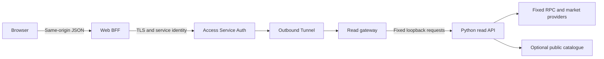

# Public read bridge and wallet sessions

Status: read bridge implemented as a disabled candidate for
[issue #5](https://github.com/domino-money/domino/issues/5), on top of the pending
backend 0.8.0 candidate. See the [implementation evidence](../reports/READ_BRIDGE_IMPLEMENTATION.md)
and [local gateway runbook](READ_GATEWAY_RUNBOOK.md). No public service is deployed,
frontend hook connected or wallet session implemented by this change.

## Decision and delivery order

Use the web application's own origin for browser requests and a small backend
gateway for explicitly allowed reads. Users may inspect public tokens, pools,
wallet balances and NFT owners without signing a login message. Authenticated
private preferences are a separate capability and do not authorize transactions.

1. Complete the producer/consumer response contract and deterministic fixtures.
2. Implement and test the read bridge with synthetic upstreams, disabled by default.
3. Announce the candidate contract and staging switch to OxDecimal, complete the
   checks below, then enable an invited read-only staging cohort.
4. Implement wallet sessions in a separate slice before adding private settings.

Steps 1–2 have local implementation and offline evidence. Steps 3–4 remain release/session work. No live swap, mint, automation,
signer or private-account write is admitted by the read bridge. Reference
[compatibility and notices](API_COMPATIBILITY.md) and the
[acceptance tests](API_READ_BRIDGE_TEST_PLAN.md).

## Deployment and service identity

Proposed target: the web server/Worker provides a backend-for-frontend (BFF).
One small Linux backend deployment runs a gateway, the local Python reader and
an outbound Cloudflare Tunnel. This uses the existing Python service and does
not require a cluster, Redis or the home GPU servers. The selected app origin is `https://domino.money`. Cloudflare credentials and
configuration are explicitly deferred by the owner. The proposed backend
hostname `https://read-origin.domino.money` has not been provisioned or qualified. The existing Sites preview is not assumed to
have the required secrets, route control or production identity.

For invited staging, a separate Access application at the web origin admits
only the named testers and covers both pages and `/api/*`. Verify that no
alternate Worker/preview hostname bypasses that gate. This is testing access,
not wallet ownership; "without login" for public reads means no wallet sign-in.
The browser perimeter and backend Service Auth application have different
audiences/policies. Keep live flags off until that staging gate is tested.

Cloudflare Access supports service credentials sent by the server in the
`CF-Access-Client-Id` and `CF-Access-Client-Secret` headers with a Service Auth
policy. These identify our BFF, not an end user. The gateway must verify the
Access assertion against the configured issuer, application audience, expiry
and signing keys; a header merely being present is insufficient.
[Service credentials](https://developers.cloudflare.com/cloudflare-one/access-controls/service-credentials/service-tokens/),
[JWT validation](https://developers.cloudflare.com/cloudflare-one/access-controls/applications/http-apps/authorization-cookie/validating-json/).

Domino deployment requirements:

- Access admits only the environment's read-BFF service identity; no Bypass,
  public Allow or interactive-login fallback for the origin application.
- Tunnel ingress points to a fixed gateway listener on loopback. No externally
  reachable reader, gateway or database port; unmatched tunnel paths return 404.
- The gateway validates a JWT using an established library, pinned algorithm
  and configured issuer/audience/JWKS host. Never follow token-supplied key URLs.
  Bound refreshes, reject unknown keys when refresh fails, and test rotation and
  expiry. Validate the admitted service identity as supported by the assertion
  contract, with a staging fixture from the actual Service Auth configuration.
- BFF and gateway enforce exact method/path maps. Browser-supplied URL, host,
  route suffix, RPC method, chain or network selector cannot change a destination.
  Redirect following is disabled, including redirects to login pages.
- The gateway builds a new request to `http://127.0.0.1:8876` from validated JSON.
  It does not forward browser `Origin`, `Cookie`, `Authorization`, `Host`,
  `Forwarded`, `X-Forwarded-*`, `Sec-*`, Access headers or arbitrary headers.
  This reconstruction occurs only after authenticated ingress and browser checks;
  stripping Origin in an unauthenticated proxy is not an acceptable bridge.
- The reader's existing loopback/Host/Origin restrictions stay enabled. The
  local development command still binds only to loopback. The gateway must not
  be introduced as an unrestricted localhost proxy.
- The BFF accepts client IP only from the deployed edge's trusted connection
  metadata, overwrites forwarded client identifiers, and transmits a bounded
  rate-limit identifier to the authenticated gateway. Untrusted incoming
  identity headers never select a budget or owner.

The initial backend has exactly one gateway and one reader process. Their
in-memory budgets and cursors are not horizontally scalable. Replica changes
require a separate state/rate-limit design and tests, not an autoscaling flag.

## Browser route contract

All nine paths are implemented in the disabled 1.1.0-rc.3 candidate; no public
endpoints are active. Each requires a route flag and consumer/release evidence. Public
names differ only by the explicit prefix mapping. JSON request and successful
response field names remain those of the selected backend contract. No `data`
wrapper, symbol-based renaming or conversion of raw amounts to numbers.
The one declared successful-payload value transformation is replacing the
internal inventory cursor with a browser-safe opaque handle, as specified below.

| Browser method/path | Fixed backend path | Admission |
| --- | --- | --- |
| `POST /api/read/v1/token` | `/v1/read/token` | First read cohort |
| `POST /api/read/v1/pools` | `/v1/read/pools` | First read cohort |
| `POST /api/read/v1/pool-market` | `/v1/read/pool-market` | Requires PR #10 and its response contract |
| `POST /api/read/v1/wallet-assets` | `/v1/read/wallet-assets` | Requires opaque cursor handling below |
| `POST /api/read/v1/nft-positions` | `/v1/read/nft-positions` | First read cohort; ownership is public data |
| `POST /api/read/v1/catalogue` | `/v1/read/catalogue` | Candidate implemented; revision/coverage tests |
| `POST /api/read/v1/pool-activity` | `/v1/read/pool-activity` | Candidate implemented; bounded response contract |
| `POST /api/read/v1/pool-positions` | `/v1/read/pool-positions` | Candidate implemented; bounded response contract |
| `POST /api/read/v1/pool-metrics` | `/v1/read/pool-metrics` | Candidate implemented; explicit qualification/unavailability |

Disabled entries return the agreed unavailable-route error without making an
upstream request. Never relay `/health`, `/openapi.json` or local
`/v1/capabilities`. The existing practice `/api/v1/capabilities` and
`/api/v1/compound-preview` keep their behavior and names.

A new, explicit `GET /api/read/v1/capabilities` describes the deployed bridge:
`contractVersion` (string), `dataMode` (`disabled` or `live_read_only`), `chainId`
(4663), `enabledReads` (allowlisted suffix strings), `walletAuthentication`
(boolean), `privateAccounts` (boolean), `ownerTransactions` (false),
`automation` (false). It is authored by the BFF deployment and does not copy the
internal reader's development capabilities. All flags start disabled. Schemas
and fixtures for this new response must land before a frontend hook uses it.

Requests require exact configured HTTPS Origin for POST, same-origin Fetch
Metadata when present, `application/json`, and no CORS permission. Reject
`Origin: null`, foreign/sibling origins and ambiguous/duplicate sensitive
headers. For the capabilities GET, reject foreign Origin when present and
cross-site Fetch Metadata; same-origin fetch may legitimately omit Origin.
These browser checks reduce abuse; spoofable headers are not authentication.

Preserve current body bounds: 8,192 bytes, ten fallback tokens, twenty pool
checks, ten explicit pool IDs no greater than `maxPools`, ten distinct uint256
NFT IDs and catalogue page limit 100. NFT blockNumber and catalogue revision
are nonnegative JavaScript-safe integers, at most 9007199254740991. Use the exact endpoint request schemas;
unknown fields, non-JSON bodies, boolean-as-integer and numeric raw amounts
remain invalid. Enforce the body bound while streaming, before parsing.
Reject request content encodings other than identity; decompress no browser
payload. Reject duplicate JSON object keys instead of selecting one value.

Successful body semantics include `schemaVersion`, exact address/PoolId identity,
`mode`, block/hash snapshots, optional decimals, raw integer strings, source
times, coverage, and null versus measured zero. Validate output against the
pinned response schema; malformed or incompatible upstream data must not be
silently repaired or fed to frontend hooks.
Render token symbols and provider labels only as escaped text. A schema-valid
string is not trusted HTML. Never automatically fetch provider metadata URLs
or inject them into HTML, image or link destinations without a separate policy.

Bridge errors use `{ "error": "<stable_code>" }`, with no provider payload,
validation input echo or stack trace. Preserve reviewed backend error codes and
status meanings; publish a finite code set in the response contract. Map unknown
backend errors to `upstream_unavailable`. New bridge codes and statuses:

| HTTP | Code / meaning |
| --- | --- |
| 403 | `origin_not_allowed` |
| 404 / 405 | `route_not_available` / `method_not_allowed` |
| 408 / 413 / 415 / 422 | `request_timeout` / `request_too_large` / `json_required` / `invalid_request` |
| 429 | `read_capacity_busy`; bounded integer `Retry-After` |
| 502 | `upstream_contract_mismatch` or `upstream_invalid_response` |
| 503 / 504 | `upstream_unavailable` / `upstream_timeout` |

Retain `400 invalid_or_expired_cursor` and `409 catalogue_revision_changed` as
distinct recovery states. Infrastructure login HTML/redirects, 401/403 and
unclassified 5xx become a sanitized 503; they do not ask a wallet to sign in.
All browser responses are JSON, `Cache-Control: no-store` and `nosniff`.
Allowlist response headers; discard upstream cookies, redirects and diagnostics.
Generate a bounded opaque request ID for support and return it in
`X-Domino-Request-Id`, separate from the stable response body.

## Budgets, freshness and failure behavior

These are implemented candidate limits for invited alpha, not measured capacity
or a service SLA. Account limits belong to the later session slice.

| Control | Initial value / behavior |
| --- | --- |
| Per-IP read budget | 30 requests/minute, burst 5; all replicas of the BFF share the gateway's authoritative budget |
| Verified-account budget when present | Also 30/minute, burst 5; neither account nor IP replaces the other limit |
| Global backend read admission | One actual operation in flight; at most one start/second; no waiting queue |
| Provider budget | Keep PR #10's shared 25 market requests/minute; no retries to bypass it |
| Browser body deadline | 5 seconds, included in 20-second total request budget |
| Upstream work budget | At most 15 seconds remaining after validation, including subrequests; transport timeouts cannot reset it |
| Response limit | 1 MiB decoded JSON, streamed bound; oversized output is an error, never silently truncated |
| Rate-limit state | At most 10,000 active keys, idle expiry 5 minutes; reject new keys if full instead of evicting active budgets |

The current reader does not implement a cooperative end-to-end RPC deadline.
Add and test that control before exposure. A browser abort or edge timeout does
not prove Python stopped; hold/reconcile admission until actual work exits.
No automatic bridge retry. Provider outages must not spawn backfills, duplicate
work or unbounded pending tasks. If the authoritative limiter or gateway is
unavailable, return 503 rather than bypassing controls.

Do not add CDN, BFF or whole-response stale caching initially. Keep PR #10's
bounded market-observation cache: fresh for 60 seconds, stale fallback up to
300 seconds of age since its original successful retrieval, and a 15-second
error cooldown. Fresh means age <60 seconds; after refresh failure, stale data
may be returned only while that original age is <=300 seconds. Failure/retry
never resets the observation's age. Chain state is still rechecked. Retrieval
age is not provider update time. No stale success when
canonical chain verification failed; the frontend may retain its previous card
with the original timestamp and an explicit read-failure state.

Wallet/NFT responses and cursors are never shared-cache entries. Client query
keys include contract major, chain, route and all identity-affecting parameters,
including wallet, token filters, pool, chart currency, block and page. Preserve
cache data per key; abort/ignore late results after selection changes. Never
replace failed live reads with practice amounts under the live-data label.

## Pagination and wallet identity

The existing inventory cursor is signed, not encrypted: its payload contains
provider pagination state. Its HMAC secret is random per reader process and its
TTL is 300 seconds. Do not expose it directly through the browser bridge.

The gateway returns a random 256-bit opaque handle in the existing
`inventory.nextCursor` field. A bounded in-memory table maps its hash to the
internal cursor, normalized wallet/fallback-token context, reader generation
and expiry. Request `cursor` is exchanged back only after context validation.
The handle's expiry cannot exceed the internal cursor's remaining TTL; wrapping
or retrying cannot extend it. At most 2,048 unexpired entries; refuse additional
allocation with 429, and do not invalidate still-valid handles by silent eviction.

One gateway/reader generation is deliberate for the first cohort. Restart,
provider change or reader replacement invalidates handles explicitly. Return
400 so the adapter can restart the first page once, preserve old rows as old,
and merge only by chain/address with per-page timestamps. On provider failure,
preserve the failed request's handle for a bounded user retry before expiry.
The opaque handle is pagination state, not proof of wallet ownership.

Catalogue 409 requires restarting with the same pair filters, no old
`afterPoolId`, and a fresh revision. Empty partial results never prove that a
pool does not exist. Public-address/NFT reads may accept another person's
address; they must never be reused as private-record authorization.

## Wallet-session design for the subsequent slice

Use Sign-In with Ethereum (SIWE). The standard binds a parsed message and
signature to the expected origin, address, chain, nonce and time fields; a
session is associated with the address. Contract-account validation has
different rules and may change with chain state.
[ERC-4361](https://eips.ethereum.org/EIPS/eip-4361).

The following lifetimes and endpoints are Domino design choices, not SIWE
defaults. They remain disabled and require their own implementation evidence.
The future gateway auth module terminates these routes separately from the
public reader, using its own private-store role. The BFF forwards only the
named session/pre-login credential and CSRF value to that authenticated module,
never an unrestricted browser Cookie header and never credentials to the
local read API. Private settings require a separate explicit route map.
All auth POST routes inherit the streamed 8,192-byte body limit, identity-only
content encoding, JSON/duplicate-key checks, five-second upload deadline and
20-second total request budget. Before signature parsing, bound the exact SIWE
message to 2,048 UTF-8 bytes and the initial plain-EOA signature to exactly
65 bytes encoded as 132 hex characters including `0x`. Unsupported signature
formats are explicit compatibility failures, not an excuse to skip validation.

| Proposed endpoint | Meaning |
| --- | --- |
| `POST /api/session/v1/bootstrap` | Create pre-login browser context and CSRF token; exact Origin required |
| `POST /api/session/v1/challenge` | Bind a server-generated SIWE message to context, address and chain 4663 |
| `POST /api/session/v1/verify` | Verify the exact issued message/signature and atomically consume the challenge |
| `GET /api/session/v1/me` | Read current session and refreshed CSRF token; no wallet/role supplied by caller |
| `POST /api/session/v1/logout` | Revoke the server session and clear its cookie |

- Generate at least 128 random bits for an alphanumeric nonce, a separate
  challenge identifier and a 256-bit pre-login secret. Challenge expires after
  five minutes and binds canonical configured HTTPS domain/URI, address, chain,
  issued/expiry times and a fixed sign-in-only statement. No spending, terms
  amendment or automation approval is hidden in the login message.
- Store the exact issued message and hash of the pre-login secret server-side.
  Reject arbitrary client-composed messages, wrong context/account/chain,
  expiry and unexpected fields. Limit five verification attempts per challenge.
- Use a reviewed SIWE/parser/signature library with exact-version tests, not
  handwritten address recovery. For initial sessions admit only verified plain
  EOAs. Deployed contract accounts, delegated-code accounts (including EIP-7702)
  and counterfactual signatures are explicitly unsupported until their validation
  and revocation rules are tested. Never infer wallet type from its brand or
  fall back to EOA recovery after a failed contract check. Unknown code state
  fails login; public reads remain usable. See the distinct account behaviors in
  [ERC-1271](https://eips.ethereum.org/EIPS/eip-1271) and
  [EIP-7702](https://eips.ethereum.org/EIPS/eip-7702).
  Verify code state at a pinned canonical chain snapshot and record the method
  and block. For the initial plain-EOA policy, recheck code on each authenticated
  private request; nonempty code revokes the session, while an unavailable read
  denies that request without guessing wallet type. A changed validation policy
  also requires reauthentication. Broader account support needs its own tested
  revalidation rules.
- After signature verification, one database transaction conditionally consumes
  the unexpired unused challenge and creates the session. Two concurrent valid
  submissions yield at most one session. A lost response requires a new challenge,
  not reuse of a consumed signature. Rotate pre-login state and an expired or
  inactive prior session cookie. As clarified by the #31 implementation review,
  bootstrap and verify refuse a presented active session: logout must complete
  before another context can sign in. This avoids cross-tab replacement/logout
  races without introducing unreviewed session-family authority.
- Sessions use a random 256-bit opaque cookie; store only its hash with owner
  address, chain, created/last-used times, expiry and revocation. Absolute lifetime
  12 hours, idle limit 30 minutes; extension never exceeds the absolute expiry.
  Enforce expiry on each request server-side, not by browser cookie expiry alone.
- Use `__Host-domino-session` and `__Host-domino-preauth` cookies with `Secure`,
  `HttpOnly`, `SameSite=Lax`, `Path=/`, no Domain. No session bearer in localStorage,
  URLs or frontend logs. Pre-login state expires in ten minutes.
- Challenge, verify, logout and future private writes require exact Origin,
  JSON, a server-bound CSRF token in `X-Domino-CSRF`, and Fetch Metadata checks.
  Bootstrap creates no authenticated state and must not overwrite an existing
  authenticated session. Return all auth responses with `no-store`; never relay
  these cookies through the public reader.
- Store challenges/sessions in a separate private database/schema with an
  auth-only least-privilege role. Public catalogue credentials have no access.
  An account header/body field cannot set the tenant. Future private routes
  derive owner context from the verified session and enforce tenant isolation.
- Account/network changes clear the active private view and require login for
  the new identity. The server cannot observe a wallet UI change: it continues
  to authorize only the identity bound to its existing session. Logout revokes
  that session in shared storage; do not rely on hiding a button or clearing a
  cookie alone. No private-route stateless positive session cache initially.
- Limit bootstrap/challenge to 5/minute/IP and 20/hour/address for challenges;
  verify to 10/minute/IP plus the challenge attempt cap. Successful users also
  retain per-account/IP private-request limits. Address limits are abuse controls,
  not proof that an anonymous caller controls the address. Hash/enforce keys
  centrally and return 429 without revealing account existence.

Origin and server-bound CSRF tokens are required in addition to SameSite;
SameSite alone does not distinguish all sibling-origin attacks.
[OWASP CSRF guidance](https://cheatsheetseries.owasp.org/cheatsheets/Cross-Site_Request_Forgery_Prevention_Cheat_Sheet.html).

Session signing proves login only. It never grants ERC-20 approval, NFT
authority, an operator signature, treasury access or a right to another owner's
settings. Financial intent and tenant tests stay outside this read release.

## Secrets, observability and rollout

Keep Access credentials in the BFF's environment-specific secret store. Keep
RPC/Uniswap keys only in the backend's store. Production credentials are not
copied from the personal bot or committed development configs. Use separate
staging/prod service identities and database roles, with tested expiry/revocation
and a bounded overlap for planned credential rotation. Never return secrets,
service assertions or provider URLs containing keys to the browser.

Record request ID, route, contract/build version, duration, status, safe reason,
cache/limiter outcome and deployment-mode changes. Do not record JSON bodies,
full addresses/cursors, cookie values, signatures, Access assertions or upstream
payloads. Keep application diagnostic records seven days initially; aggregate
operational counts may remain 30 days. Short-lived rate keys use a server-keyed
identifier; do not call them anonymous identities. Configure edge, tunnel and
error-reporting logs consistently before release, including redaction tests.

Alert on contract mismatches, service-auth failures, deadline overruns, exhausted
provider budget and sustained read failures. Include contract/build IDs in
deployment audit records. Never page on every routine 429.

The switch to real data is a coordinated release event, even if no field changed.
OxDecimal receives the contract version/digest, routes, payload fixtures, safe
error states, affected frontend hooks, deployment target and rollback in advance.
Record his acknowledgement and both test results on the release PR. All code
may continue in parallel behind disabled flags while that integration is pending.

Initially enable only the declared read routes for a small invited cohort.
Rollback disables live reads and renders an explicit unavailable state while
retaining timestamped observations; it never labels mocks as live or widens
backend access. Backend and frontend build IDs must remain compatible during
rollout/rollback. No change to funds or chain authority occurs in this rollout.
