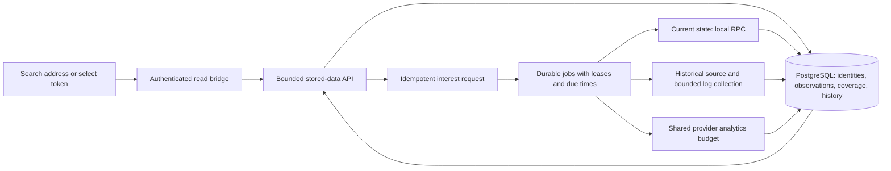

# Persistent, fast data for every searched token

Status: implementation plan, 19 September 2026. No changes described here have
been activated by publishing this document.

Owner requirement: correct the measured frontend lag and make discovery, current
data and history persist for **any token a user searches**, with the same service
objectives as the six featured pools. Scope remains Robinhood Chain, chain 4663.
The six pools become presentation defaults, never a data admission list.

Baseline and evidence: [production latency investigation](../reports/FRONTEND_DATA_LATENCY_2026-09-19.md).
Three loads took 19.46–21.24 seconds, 68–73% spent waiting; a stored six-pool
response took a median 2.82 ms. Current RPC state, provider analytics and durable
historical activity have different freshness failures and must be fixed separately.

## 0. Reuse the work already delivered

Reconciled against `origin/main` at `bc336b5`, GitHub discussions and local
worktrees on 19 September 2026. The [reuse audit](../reports/GENERIC_TOKEN_REUSE_AUDIT_2026-09-19.md)
records authors, commits, branch integration and remaining runtime gaps.
This is an incremental extension of that work, not a replacement architecture.

| Existing foundation | Reuse and remaining delta |
| --- | --- |
| Durable pool queue, narrow request function and fair rotation (`8bdf831`, `85f4163`) | Extend migration 020 and its repository for recurring demand and fencing; add token interest. Do not introduce a competing acquisition queue. |
| Arbitrary-pool identity, followers and adaptive spans (`774f5b1`, `55efb5a`, `914e8ba`) | Connect the existing adaptive algorithm to queued indexing and schedule following pools continuously. |
| Server snapshot, bridge, restart persistence and background refresher (`a1cd01f`, `c13238f`, `27a1d73`) | Migrate useful observations with original ages, remove the durable 24-pool ceiling, include persistent metadata and enable the public path. |
| Stored/provider admission lanes (`48d84d5`) | Fix gateway health gating and route classification; preserve canonicality checks. |
| Public explorer, shared scheduler, pagination and progressive snapshot consumption (`4592e67`, `7e7173c`, `39c59c2`) | Reuse these components; connect durable data, refresh successful results and let each chart progress independently. |
| Recent live-window projection and truthful coverage (`c0d647b`, `1458815`, `6d08cde`, `d5b0542`) | Persist acquisition asynchronously and select windows by timestamp; retain the corrected coverage semantics. |
| Canonical activity/fee/position/capital and financial history (`918b45e`, `03ec1fa`, `26e7294`) | Schedule and qualify existing reducers/checkpoints; add missing public chart projections. |

The existing queue/identity/follower branches are already integrated. The public
explorer and financial-history branches also contain work incorporated by squash
or integration commits. Do not re-merge those old branches merely because their
original commit IDs are not ancestors of main.

## 1. Product behavior

| Situation | Required behavior |
| --- | --- |
| First search for a valid address | Persist the interest, validate token identity and discover supported pools; return available data progressively and schedule missing work once. |
| Another person searches the same token | Reuse the same durable identity, observations and history; do not create a second reconstruction. |
| Browser closes, VM restarts, or app deploys | Previously collected data and checkpoints survive; workers resume unfinished work. |
| Token has many pools | Persist discovered identities and paginate results. Update visible/requested pools first while other discovery/history work progresses fairly. |
| History for the requested window exists | Serve precomputed history from storage, without replaying blockchain events in the HTTP request. |
| History does not yet exist | Serve current data and any covered interval, expose missing coverage/progress, and continue collection after the visitor leaves. |
| Token has no discovered supported pool | Keep its validated identity and discovery coverage; distinguish no result in the scanned scope from proof that no pool exists anywhere. |
| Name/symbol search | Search the durable verified token registry, return address-distinguished candidates; an unknown name is not permission to guess a contract. Exact-address search remains universal. |
| Token lacks metadata, USD coverage, or compatible accounting | Display the supported fields and precise unavailable/partial states. Never invent decimals, prices, APR or history. |

A previously unseen token's complete lifetime history cannot be reconstructed
instantaneously. The commitment is fast existing-data reads, quick progressive
first use and durable completion of missing work—not hiding that work in a
20-second spinner or falsely reporting complete coverage. Discovering a token
does not authorize a trade or qualify it for execution.

## 2. Proposed measurable objectives

These are acceptance targets to verify, not performance already achieved.
Measure authenticated public HTTP and real browser rendering separately, including
cold/warm state, error rate, refused admissions and observation age.

| Path | Initial target inside the qualified capacity envelope |
| --- | --- |
| Persisted token/pool overview | Public API p95 <= 1 s; usable visible data p95 <= 2 s. |
| Persisted 24h/7d/30d chart, <=600 returned buckets | Public API p95 <= 1 s; visible chart p95 <= 2 s. |
| New token | Stored admission/progress response <=1 s p95; metadata/current-data result <=3 s p95 when the required providers respond normally. Track pending/timeouts separately, never count progress-only as successful data. |
| Visible current chain state | Target <=15 s age at display under normal source operation. |
| Already caught-up active pool activity | <=120 s behind chain time; distinguish latest/provisional from the configured confirmed anchor. |
| Provider TVL/volume/estimates | Target refresh <=60 s for the qualified active set when provider budget permits; always expose actual source age and rate-limit state. |
| Deep historical reconstruction | Durable progress, bounded retry and no starvation; completion ETA only after measuring that pool's remaining work and throughput. |

A token's identity has the same behavior regardless of whether it was featured.
Finite hardware/provider capacity limits simultaneous freshness, not which token
addresses may be known. Publish the measured active-set envelope and degradation
behavior; do not silently promise <=60 s external analytics for unlimited pools.

## 3. Serve stored projections; collect once in workers

Use existing PostgreSQL, reader/gateway boundaries and systemd services. A Redis,
Kafka or public RPC proxy is unnecessary for the first delivery. In-memory caches
may accelerate reads but are not authoritative storage. Cache eviction must never
remove a token, its discovered pools or its acquired history.

The read role may request work only through narrow validated database functions,
as `request_pool` already does. It cannot change job completion, canonical
checkpoints or accounting ledgers. Workers validate provider/chain data before
publishing it. Search interest is aggregate chain/address demand, not a permanent
record of which wallet or person searched for it.

Record demand only for a submitted complete, syntactically valid address or an
explicitly selected result, never for each keystroke. A candidate's durable
validation state may be pending/rejected; registering it is not verification of
an ERC-20 contract. The narrow function does not accept a client-selected job
priority, observation payload or checkpoint.

## 4. Durable schema and identity

Add versioned migrations alongside the existing catalogue/activity schema. Assign
migration numbers against the current main branch during implementation.
Extend the existing catalogue and migration-020 request queue in place where
their semantics fit. The table below describes logical responsibilities, not a
requirement to create six new independent tables. Any replacement of queue state
needs an explicit idempotent migration and single-writer transition.

| Logical data | Key and stored evidence |
| --- | --- |
| Token registry and metadata observations | `(chainId,address)`; validated block/hash, metadata values/status/version, observed time, first/last requested, next validation due. Metadata can change; code hash alone is insufficient for upgradeable tokens. |
| Token-to-pool discovery | `(chainId,address,poolManager,poolId)`; verified pool key, discovery source, block/hash and discovery scope/cursor. Hints remain candidates until chain verification. |
| Pool interest | `(chainId,poolManager,poolId)`; first/last requested, bounded popularity signal, active-until and next due. Identity validation precedes expensive admission. |
| Current observations | Entity/source/observation identity; values, original observed/retrieved times, block/hash, canonical revision, eligibility and stale deadline. Keep chain and provider observations distinct. |
| Durable jobs | Entity + job kind + window/generation; state, due time, lease token/expiry, attempts, retry time, error class, adaptive span and checkpoint reference. Uniqueness coalesces equivalent work. |
| History coverage and projections | Pool/source/methodology/window/revision; explicit covered intervals and gaps, reconciliation state, aggregates/candles and their canonical ancestry. Reuse existing canonical activity and financial ledgers. |

Index address-to-pool lookup, due-job selection, source/observation age and
pool/timestamp history access. Use keyset pagination tied to a revision. Chart
queries choose a stored resolution; no full-table scan or unbounded response.

Existing tables are single-chain/single-manager by deployment. New identities
include chain and manager; adapters validate these against existing storage until
a separate migration is justified. A symbol, artwork identifier or an arbitrary
provider pool name is never a key.

Remove the **global retention limit of 24 pools** from the durable path. Retain a
bounded request page (initially up to 24 rows) and bounded process caches. Keep
all validated requested entities, useful observations, completed history and
checkpoints durable. Old inactive entities may refresh less frequently, but a
new request promotes them without losing their data.

Initial retention: do not delete existing or newly acquired canonical history as
an optimization. Keep hot current observations compact and historical candles/
checkpoints durable. Measure bytes per pool/day, database/index growth, backups
and NAS/archive restore before introducing any explicit raw-event compaction.
Never make warm-read availability depend on the original visitor remaining online.

## 5. Work scheduling and recovery

Separate job kinds and capacities: token validation/discovery, current pool state,
recent activity acquisition, deep backfill, financial reconstruction, provider
analytics and read-model publication. Entity/history readiness is not the job's
lease state. A job reaching `following` means “caught up; schedule the next due
pass”, never removal from future work.

Use a durable state machine such as `pending -> leased -> complete` for a bounded
unit, with `retry_wait` and `blocked` outcomes. A recurring job computes its next
`due_at` after completion. Expired leases can be reclaimed; publication checks a
lease/generation fence so a late old worker cannot overwrite newer work.
Checkpoints and publication commit atomically and are idempotent.

The current public queue already deduplicates requests, recovers stale claims
and rotates by least-recently-served time. Add recurrence, due times and fenced
publication to that foundation. Private performance enrollment already provides
examples of leases, a global RPC budget and minute projections (`275e5f3`,
`de529f2`, `5f8b3c1`); reuse pure helpers/patterns, never its private owner tables,
RLS boundary or visibility-based expiry for public collection.

Scheduling rules:

- Reserve capacity for visible/current reads and for new-token first results.
- Reserve a nonzero share for older queued work/deep history; repeated searches
  cannot continually move one popular token ahead of everything else.
- Deduplicate identical users' requests; debounce aggregate interest updates.
- Process bounded ranges/time slices, then yield. Use backoff with jitter and
  source-wide cooldown on 429. Retain useful progress across restarts.
- Connect the existing `AdaptiveSpan` and bounded within-pass retry to the
  queue-worker path, which still uses a fixed span. Recognize the demonstrated
  log-size refusal structurally and persist the useful smaller span. A dense
  single block receives a separate bounded diagnostic, not infinite halving or
  a false success.
- Distinguish transport outage, provider size limits, missing historical state,
  invalid identity and canonicality failures. Do not retry authentication or
  invalid data indefinitely under the same policy.
- Limit new-entity discovery/job creation per client and globally, separately
  from cheap persisted reads. Invalid addresses/repeated negative results get a
  short-lived negative cache; transient outages never become permanent absence.

Workers must follow the same current/history routing as the reader. Update the
older queue-worker deployment explicitly; `install_read_release.py` does not do
that. Use the local RPC for qualified current state, and `historicalRpcUrl` for
old state/reconstruction. Qualify log retention and range behavior before moving
any older log workload to the pruned local node.

Start with bounded polling and shared head observation, then grouped pool log
queries with measured topic/range limits. WebSocket is optional later acceleration,
never the source of durable truth: reconnect, gap fill and removed-log/reorg
handling are prerequisites. No token or pool requires its own permanent connection.

## 6. Fast history without incorrect accounting

Prioritize the requested recent window (24h initially) while older coverage is
collected. Offer 7d/30d/lifetime ranges according to available source coverage;
keep the requested window and actual covered intervals explicit.

Locate time-window boundaries from block timestamps with a bounded search. The
existing live path scans roughly 86,400 blocks, which covers hours rather than
a day on this chain. `1458815`, `6d08cde` and `d5b0542` already corrected its
coverage claims and display. Preserve those fixes; the remaining change is to
acquire the requested elapsed-time window durably, not to repair the labels again.

Recent swap logs and pool-ratio candles can be collected independently of a full
liquidity replay, but they are a separate projection. Do not insert them as a
contiguous complete activity ledger from pool creation. Current LP assets, fee
reconciliation and historical APR require their verified initialization or a
trusted compatible checkpoint and ordered replay.

Reuse activity -> fee -> position -> capital dependencies and existing
methodology/source digests. Publication occurs only when its required inputs
are canonical and reconciled. Track separate watermarks for these stages and for
USD price qualification; one generic `ready` flag would conceal missing work.
Price identity includes chain, token, quote denomination, source and methodology.
Do not combine unrelated pools or substitute a same-symbol Ethereum token for a
Robinhood token's price history.

Aggregate canonical events into bounded chart resolutions (for example minute,
hour and day buckets) with correction/invalidation on reorg. Empty complete
intervals and unknown intervals are different. Never fill missing history with
current prices or provider APR. Preserve existing pricing, fee and reinvestment
policies; these are public read collectors, not activation of financial signing.

## 7. API and frontend changes

Keep existing read-v1/v2 strict contracts and consumers working. First use their
existing token, catalogue, pool, snapshot, activity, metrics and APR routes behind
the corrected admission and persistence layers. `read-v3` is not a prerequisite
for those fixes or for successful-data refresh.

Specify only the wire fields existing contracts cannot express: bundled metadata,
independent readiness, durable acquisition progress and additional history
windows/resolutions. Publish an additive stored-projection contract only for that
delta (a version such as `read-v3` remains an option). Never silently add fields to
strict envelopes. The following are required capabilities, not necessarily four
new endpoints or a replacement adapter:

- Token overview/search: durable metadata, paginated verified pools, discovery
  coverage and request/job status.
- Markets page: bounded collection of rows with metadata, current figures,
  existing qualified estimates and per-field provenance in one response.
- Pool overview: one pool's figures and independent readiness/coverage for its
  charts, activity, fee/position/capital history.
- Pool/token price history: explicit window, quote/source, resolution, revision,
  coverage/gaps and bounded returned points.

A persisted overview must make zero upstream provider calls. Missing data records
interest and returns an explicit partial/pending state. Any optional first-use
validation belongs to a bounded separate job/path, not a hidden fallback inside
the supposedly cheap route. If persistence is unavailable, report that acquisition
was not durably accepted; do not falsely promise it will continue.

Preserve v2 APR output behavior in the new aggregate: compute estimates from
compatible stored evidence under the existing validator, or expose the exact
reason an estimate cannot be supplied. Simply enabling the old snapshot would
otherwise discard estimates consumers currently display.

Correct admission at reader and gateway using actual work, not only route names:
stored projections get bounded independent capacity and no provider-wide health
veto. Existing `pool-metrics` performs RPC canonicality checks; either retain it
on the provider lane or publish a separately validated stored canonicality
watermark. Never bypass that proof just to make a route faster. Preserve the
separate development gateway's acquire/release and budget contract.

Extend the existing shared source, scheduler, retained-row snapshot path,
`pagers.ts` and `catalogueSession.ts`; do not build a second explorer or transport.
Frontend query keys include chain/address or manager/pool, filters, source,
window and revision. Give home, Explore, search, pool pages and revisits the same
shared query state. The six featured pools merely supply initial query IDs.
Include metadata in responses; stop re-reading seven tokens to name six rows.

Use bounded refresh of successful visible data, deduplicate requests, cancel
irrelevant requests, pause polling when hidden, and prioritize the selected
pool/chart. A chart must not wait for unrelated rows to settle. Show retained data
while a revalidation runs, with its original timestamps; a cache hit never makes
old data new. Per-query failure/backoff must not freeze all cached content.

Keep beta/session checks before all responses. Share only public validated market
payloads internally; wallet balances, inventories, private positions, cookies,
Access assertions and signing state are excluded. Initial delivery can keep
`no-store` at the HTTP boundary and use the durable server cache. Conditional
GET/ETag or edge caching is a later measured optimization, with explicit contract
and authentication tests—not a prerequisite for the first fast implementation.

A display snapshot does not replace the fresh identity, ownership, price/bounds
and simulation checks of deposit, setup or signing workflows. Their private
query cache and session/tenant separation remain independent.

## 8. Delivery sequence

| Increment | Concrete changes | Completion evidence |
| --- | --- | --- |
| A — fix proven admission and stuck-work errors | Correct existing stored/provider admission and gateway health gating; connect existing AdaptiveSpan/retry to queued indexing; expose truthful stalled-work metrics. | Existing four admission reproductions corrected; one affected historical chunk commits and resumes correctly. |
| B — extend durable generic acquisition | Extend catalogue/request queue with token registry, interest, observations and recurring fenced work; connect submitted search to narrow idempotent requests; import existing snapshot records with original ages. | A following pool advances without manual requeue; a nonfeatured token and >24 pools survive process/cache eviction, browser close and restart; duplicate users create one logical acquisition. |
| C — extend stored projections where contracts need it | Reuse snapshot/bridge/validators and existing V1/V2; add only the contract delta needed for bundled metadata, qualified estimates and independent coverage/progress; configure public routes. | Contract parity, beta/auth and cache-isolation checks; real public persisted overview <=1 s p95 at the tested load; no provider calls in the stored path. |
| D — extend existing progressive frontend | Reuse explorer, shared scheduler, pagination and snapshot-first rows; connect durable registry, independent charts/history and bounded successful refresh. | Home, Explore and arbitrary token pages share the same behavior; no token waterfall, no global chart wait, no stale successful page left indefinitely. |
| E — integrate continuous and historical completeness | Adapt existing followers/rotation and financial reducers to recurring generic demand; persist the live-window projection; add missing canonical candles and fairness across job kinds. | >24 pools progress, hot pools retain their lag target while new/backfill jobs advance; reorg and provider failure recovery preserve correctness. |
| F — capacity qualification and staged activation | Upgrade all relevant reader/gateway/worker releases and policies, validate provider budgets, run controlled benchmarks and failure/restart drills, publish actual capacity envelope. | Targets met with measured error/age distributions; runtime flags and release revisions recorded; rollback restores prior serving without losing acquired data. |

A and a focused contract-gap review can proceed alongside B. C consumes B;
D's refresh/chart fixes can proceed on existing contracts, while its new bundled
data consumers follow C. E extends B and can advance beside C/D. Broad activation
follows measured results, not a blanket increase of concurrency or a hardcoded
token whitelist.

Principal implementation locations:

- `backend/read_api.py`, `read_gateway.py`, `dev_read_gateway.py`, `read_service.py`.
- `backend/pool_requests.py`, `manage_activity.py`, `followers.py`,
  `activity_indexer.py`, `catalogue.py`, `market_cache.py`, `markets_snapshot.py`.
- Additive `backend/migrations/` extending migration-020 semantics, existing
  repositories/followers and only the missing token/observation/projection modules;
  existing activity/fee/position/capital stores and history validators.
- Existing `api-contracts/read-v1/` and `read-v2/`; an additive package only if
  required by the wire-contract delta; contract export scripts, backend OpenAPI
  and `bridge/src/worker.mjs` with matching runtime configuration.
- `app/src/lib/read/`, `app/src/components/read/screens/TokenSearch.tsx`,
  `PoolPicker.tsx`, `PoolWorkspace.tsx`, `app/src/screens/Explore.tsx`,
  `app/src/components/markets/MarketCarousel.tsx` and the Pages bridge adapter
  `app/functions/_lib/bridge.ts`.
- `scripts/staging/` release/egress helpers and dedicated read-worker systemd units.

## 9. Migration, rollout and rollback

1. Back up existing PostgreSQL, private runtime config and source releases;
   restore-test the new schema/snapshot conversion outside production.
2. Apply additive schema and least-privilege grants. Import existing observations
   and queue states idempotently, retaining real timestamps, canonical ancestry
   and progress. Do not reset 15 following pools to block zero.
3. Run new jobs/projections on bounded work and compare identical-block results
   with the existing readers. Only one writer may own a given entity/job generation;
   do not run old and new workers against the same queue without fencing.
4. Install producer/validators first, then bridge route configuration, then
   capability-driven frontend. Record production and development separately;
   this plan does not renew the expired development access window implicitly.
5. Verify new-token/revisit/history paths across ordinary addresses, including
   pools absent from the featured list. Expand by measured capacity, not an
   address-based permanent admission list.
6. Roll back serving flags/readers if needed, pause only the new workers and keep
   additive durable data/checkpoints intact. Avoid destructive down-migrations.

## 10. Acceptance and operating evidence

Tests must cover behavior rather than mirror implementation. Extend the existing
snapshot/progressive-row, arbitrary-pool workspace, pagination/restart, queue
recovery, follower/adaptive-span and candle-gap tests.
Their existing coverage is part of the baseline, not work to recreate.

- More than six tokens and more than 24 pools; a token with >100 pool candidates
  traversed by explicit pagination, not an automatic unbounded scan.
- Duplicate searches by multiple users/tabs, old/new casing, same-symbol tokens,
  native currency, missing decimals, mutable metadata, no-pool result and invalid
  address. Identity and coverage remain unambiguous.
- Browser close, reader/worker restart, expired lease and late worker completion;
  no lost demand, duplicate accounting or overwritten newer observation.
- Existing data responds while provider jobs are held; one slow token/backfill
  cannot serialize unrelated cached pages. Refresh stops when hidden and resumes
  without a retry storm.
- Log overflow splits into a successful bounded chunk; reorg rewinds affected
  generations and dependent candles/ledgers; incomplete windows never become 24h
  totals merely because a job reports complete.
- Original estimates remain consistent; no newly enabled generic token receives
  fabricated USD, APR, balance or unsupported hook accounting.
- Large persisted catalogues (100/1,000/10,000 entities) and separate active sets
  (20/100/500 pools), with 1/10/50 concurrent sessions in a controlled harness.
  These are qualification scenarios, not assumed production capacity. Use replay/
  simulation for overload first, then bounded live canaries within source budgets.

Record warm/cold p50/p95/p99, error/admission rates, first useful data, chart-ready
time, per-source ages, current and historical watermarks, oldest due job, failed
range repetition, per-pool fairness, provider requests, disk growth and cache hit
rate. Persist evidence and compare with the baseline. Expose these metrics in the
existing private dashboard/Prometheus where appropriate; operational checks run
as bounded scripts/services, not recurring AI monitoring.

Definition of done: any valid searched token enters the same durable acquisition
and query path, survives restart/eviction, reuses data across visitors, and serves
qualified existing history within the measured targets. New history continues
independently of the original visitor, with honest progress/coverage and fair
resource use. The original six remain only the homepage selection.
